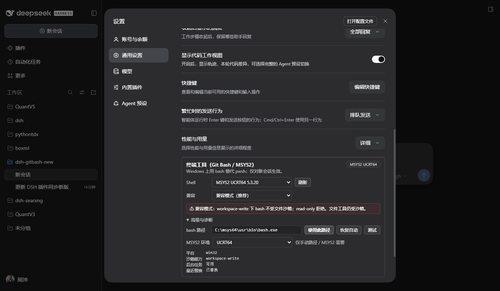
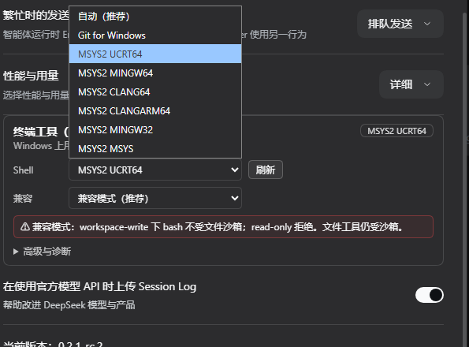
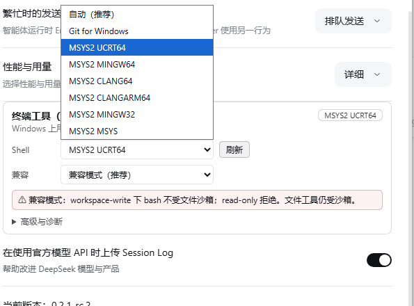

# dsh-gitbash

**English** | [简体中文](README.zh.md)

A Windows terminal bridge for **DeepSeek Harness (DSH)**. It replaces the
model-facing `pwsh` tool with a real `bash` tool, with selectable **Git for
Windows** and **MSYS2** profiles, while keeping the official terminal-tool
behaviour: working directory, background jobs, timeout promotion, permission
escalation, terminal cards, PTC and `meta.cwd`.

This is the complete user manual and reference. It covers installation, daily
usage, the security model, settings, troubleshooting and development.

> **Minimum DSH: 0.2.2.** Windows 10/11 only. The replacement applies to **new
> sessions**; existing sessions keep the tools they were created with.

---

## Contents

- [What you get](#what-you-get)
- [Requirements](#requirements)
- [Install](#install)
- [Quick start](#quick-start)
- [Security model (read this first)](#security-model-read-this-first)
- [Using the bash tool](#using-the-bash-tool)
- [Shell profiles](#shell-profiles)
- [Settings](#settings)
- [Cookbook](#cookbook)
- [Troubleshooting](#troubleshooting)
- [Diagnostics](#diagnostics)
- [Compatibility and upgrades](#compatibility-and-upgrades)
- [Development](#development)
- [Limitations and non-goals](#limitations-and-non-goals)
- [License](#license)

---

## What you get

- **One `bash`, no `pwsh`** in the model tool catalogue: `tools.restrict` hides
  `pwsh`, the `tool:pwsh` prompt section is shadowed, and `tool:bash` is added.
  The replacement applies to new sessions; existing ones are not retrofitted.
- **Two shell families, one selector**: Git for Windows (default priority) or
  MSYS2 (`UCRT64`, `MINGW64`, `CLANG64`, `CLANGARM64`, `MINGW32`, `MSYS`).
  Discovery reads the registry, `where.exe`, PATH and the usual install roots,
  validates the candidate with `bash --version`, and never proposes WSL's
  `bash.exe`.
- **Official tool contract**: `description`, `command`, `timeoutMs`, `workdir`,
  `run_in_background`, `sandbox_permissions` / `justification`, POSIX and
  Windows-form workdirs, the same `[exit code: N]`, `[stderr]` and truncation
  spill markers, and `meta.cwd` for the terminal card.
- **Background work**: `run_in_background` returns a job id; collect with
  `job_output`, stop with `job_kill`, and a foreground call past its deadline is
  promoted to a job instead of being killed.
- **Isolation instead of improvisation**: PATH entries from the other bash
  family are filtered out, `MSYSTEM` matches the selected profile, and Git's
  `bin\bash.exe` launcher is canonicalized to `usr\bin\bash.exe`, so the
  environment the plugin composes is the one that actually runs.
- **Windows-specific correctness**: the `signalNumber << 8` exit encoding
  becomes `[killed by signal: SIGTERM]`, and inherited Windows `PWD` /
  `OLDPWD` are tombstoned so `pwd` stays POSIX.
- **Native DSH display**: terminal cards, the `1 background task` /
  `1 subagent` header badges, job cards and subagent cards are rendered by DSH
  itself — the plugin registers a `bash` tool with `meta.cwd`, it does not draw
  its own chat UI.
- **A compact settings row** with automatic discovery, an instant profile
  selector, compatibility mode, one-line warning and folded diagnostics.
- **Explicit security**: never silently widens permissions. `workspace-write`
  runs bash unconfined and labels the result with `[compat: ...]`, `read-only`
  refuses, and `strict` allows only `danger-full-access`. See
  [Security model](#security-model-read-this-first).
- **Verified**: 90 unit and integration tests, plus real-machine smoke on DSH
  `0.2.2-rc.1` with Git and MSYS2 (direct, promoted, background and subagent
  calls; 31/31 scenario checks and 15/15 settings-page checks in the 0.2.4
  audit round, including strict refusal).

---

## Requirements

| Item | Requirement |
|---|---|
| DSH | `>= 0.2.2` (tested on desktop runtime `0.2.2-rc.1`) |
| Windows | Windows 10/11, x64; MSYS2 arm64 environments are also supported |
| bash provider | Git for Windows and/or MSYS2 |
| Node.js | `>= 24.9`, development/build only (the DSH 0.2.2 floor) |
| Optional | Cygwin, best-effort and not recommended |

- Git Bash and MSYS2 both use the MSYS2 runtime. That runtime cannot start
  inside DSH's Windows ACL sandbox; this is an OS constraint, not a plugin bug
  (evidence in [docs/DESIGN.md](docs/DESIGN.md)).
- WSL's `bash.exe` is intentionally excluded. WSL is not Git Bash and does not
  fit this profile/environment model.

---

## Install

### Use the CLI that ships with DSH Desktop

Do **not** use an old global npm `dsh` (for example `0.1.7`); it does not know
the 0.2.2 plugin/profile contract. Use the CLI under the desktop install:

```bat
set "DSH_CLI=%LOCALAPPDATA%\Programs\DeepSeek Harness\resources\runtime\cli\bin\dsh.cmd"
%DSH_CLI% --version
:: expect 0.2.2-rc.1 or newer
```

Fully quit DSH Desktop before changing a profile.

### From a local checkout (development)

```bat
%DSH_CLI% plugin --profile desktop add link:D:/GitHub/dsh-gitbash-new
```

Reopen DSH, then hard-refresh the Web UI (`Ctrl+Shift+R`).

### From GitHub (after publishing)

```bat
%DSH_CLI% plugin --profile desktop add github:riverzhou/dsh-gitbash-new
```

### From npm (published)

```bat
%DSH_CLI% plugin --profile desktop add @riverzh/dsh-gitbash@0.2.4
```

Use `@riverzh/dsh-gitbash@latest` for the newest release.

### Upgrade

Use the same CLI, restart DSH, hard-refresh:

```bat
%DSH_CLI% plugin --profile desktop remove @riverzh/dsh-gitbash
%DSH_CLI% plugin --profile desktop add link:D:/GitHub/dsh-gitbash-new
```

For a released version, replace `link:...` with `@riverzh/dsh-gitbash@<version>`.

### Uninstall

```bat
%DSH_CLI% plugin --profile desktop remove @riverzh/dsh-gitbash
```

Restart DSH. The settings row disappears with the plugin. A `dsh-gitbash`
entry left in the profile's `cordis.patch.yml` is inert and can be deleted
manually.

### Do not run two “bash instead of pwsh” plugins

`dsh-tweaks`' `git-bash-terminal-tool` also hides `pwsh` and registers `bash`.
If it is already installed, remove or disable it first:

```bat
%DSH_CLI% plugin --profile desktop remove dsh-tweaks-git-bash-terminal-tool
```

When both are present, the first one to replace wins; the later one usually
skips because `pwsh` is no longer restrictable. The log contains
`skipped ... pwsh is not restrictable`.

---

## Quick start

1. Install and restart DSH.
2. Open **Settings → General → Terminal tool (Git Bash / MSYS2)**.
3. Leave **Shell** at **Auto (recommended)**, or pick a specific Git/MSYS2
   profile.
4. Keep **Compatibility** at **Compatibility mode (recommended)** unless you
   want strict mode.
5. Start a **new** session and ask the model to run something:
   *“Use bash to print the shell, cwd and Git status.”*
6. Confirm the model calls `bash` (not `pwsh`) and the result carries the
   expected cwd.

The settings row looks like this:



The Shell, Compatibility and MSYS2-environment dropdowns use the DSH light/dark
surface tokens, so both the closed control and the open list stay readable:




---

## Security model (read this first)

The MSYS2 runtime cannot start under DSH's Windows ACL sandbox: restricted
tokens break its named shared memory, signal pipe and `BaseNamedObjects`. Adding
the user SID defeats write confinement; lowering to Low integrity breaks
`BaseNamedObjects` again. There is no configuration in which Git Bash both runs
and stays inside that sandbox.

The plugin therefore makes the trade-off **explicit**:

| Session permission | `compat: auto` (default) | `compat: strict` |
|---|---|---|
| `danger-full-access` | bash runs normally | bash runs normally |
| `workspace-write` | bash runs **outside the file sandbox**, result carries `[compat: ...]` | **refused** |
| `read-only` | **refused** | **refused** |

- **File tools remain sandboxed** by DSH. Only the bash process is unconfined.
- Under `workspace-write` + `auto`, bash can write outside the workspace. Treat
  paths outside the workspace as read-only unless the user explicitly asks
  otherwise.
- The plugin never silently widens permissions. The warning is always in the
  settings row, the tool description and the system prompt; every unconfined
  result also carries the `[compat: ...]` note.
- `read-only` deliberately refuses rather than breaking the read-only promise.
- `strict` is for security-sensitive users: bash is available only under
  `danger-full-access`.
- A blocked call can be retried with `sandbox_permissions` plus a one-sentence
  `justification`; DSH asks the user for approval, and the wider mode applies to
  that call only.

---

## Using the bash tool

### Parameters

| Parameter | Type | Required | Notes |
|---|---|---|---|
| `description` | string | yes | Clear 5–10 word description shown in the UI |
| `command` | string | yes | Executed as `bash -c '<command>'`; use POSIX syntax |
| `timeoutMs` | number | no | Positive; default `120000`, capped at `600000` |
| `workdir` | string | no | Working directory; relative paths resolve against the session cwd |
| `run_in_background` | boolean | no | Return a job id immediately; no timeout applies |
| `sandbox_permissions` | `workspace-write` \| `danger-full-access` | no | Request a wider mode when the session policy blocks the command |
| `justification` | string | with escalation | One sentence for the user explaining why this command needs wider access |

`run_in_background` and `sandbox_permissions` are feature-detected. The standard
web preset composes the job service and sandboxing executor, so both are
available; a minimal composition may expose only the basic parameters.

The tool runs a **fresh shell for every call**; it is `bash -c`, not a persistent
PTY. Use `workdir` rather than `cd`.

### Result format

- stdout is returned as-is; stderr is appended under a `[stderr]` header.
- An empty result is `(no output)`.
- A non-zero exit adds `[exit code: N]` as the last line; a signal adds
  `[killed by signal: X]`. A successful foreground result usually has no exit
  marker; the terminal card shows the exit status pill.
- A timeout that kills the call adds `[timed out after Nms]`.
- A timeout that promotes the call adds
  `[still running after Nms; moved to background job <id>]`.
- Large output is truncated to the tail (64,000 bytes per stream by default)
  with `[output truncated; full output: <file>]`; the full output is spilled to
  a file (up to 64 MiB).
- The compatibility notice is
  `[compat: bash runs outside the DSH file sandbox (session mode workspace-write)]`.
  It is a deployment notice, **not** command stderr.
- A background start returns `started background job <id>` and no stdout; read
  it later with `job_output`.

`tool/result.meta.cwd` is the **Windows absolute path** actually used. Inside
bash, `pwd` is the MSYS POSIX form (for example `/d/project`).

### Working directory and paths

- No `workdir`: uses DSH's current session working directory.
- Relative `workdir`: resolved against the session cwd.
- Windows absolute paths (`C:\...`) and POSIX drive paths (`/c/...`, `/d/...`)
  are accepted; `/tmp` maps to the Windows temp directory.
- Other POSIX absolute paths (for example `/home/...`) are refused rather than
  guessed, because the Windows mapping is ambiguous.
- Prefer POSIX paths inside commands; use `$VAR` and `${VAR:?}` instead of
  PowerShell syntax.

### Background jobs

- `run_in_background: true` returns a job id and continues the turn.
- Use `job_output` (with `wait: true` to block) and `job_kill` to collect or
  stop it. These are DSH's built-in job tools; the plugin registers the job as
  kind `bash`.
- The Web UI shows a background-task badge on the session header and job cards
  in the work steps.
- Background jobs have **no timeout**; stop them explicitly.

### Timeouts and promotion

- A normal foreground call is bounded by `timeoutMs` (default 120 s, cap 10 min).
- When the job service is available, a foreground timeout **promotes** the
  call to a background job instead of killing it; the result says so and gives
  the job id.
- If the job service is unavailable, the call is killed at the deadline and
  reported as timed out.

### Permission escalation

If the session policy blocks a command, retry with the narrowest wider mode and
a justification:

```text
sandbox_permissions: "workspace-write"   (or "danger-full-access")
justification: "Need to write the build cache under <path> because ..."
```

DSH asks the user. Approval applies to that one call. In `compat: strict`,
`workspace-write` is refused, so escalation must target `danger-full-access`.

### Subagents, PTC and the UI

- A DSH subagent inherits the parent's tool layer. After this plugin replaces
  `pwsh` in the parent, a new child has `bash` and no `pwsh`; this was verified
  for Git and MSYS2.
- The child runs its own bash calls in its own session; the parent receives a
  subagent card/notice and the header shows `1 subagent`. Use **View subagent**
  to inspect the child conversation.
- PTC (`run_code`) sees the same `bash` tool; the plugin supplies presenters and
  `presentationMeta.cwd`. The Web UI derives terminal cards from the tool name,
  arguments, result markers and `meta.cwd`.

---

## Shell profiles

A profile is more than a `bash.exe` path; it carries the flavour, install root,
MSYS2 environment and PATH rules.

| Flavour | Selector label | `MSYSTEM` | bash path |
|---|---|---|---|
| Git for Windows | `Git for Windows` | always `MINGW64` | `<root>\usr\bin\bash.exe` |
| MSYS2 | `MSYS2 UCRT64`, `MSYS2 MINGW64`, … | the selected environment | `<root>\usr\bin\bash.exe` |
| Cygwin | `Cygwin` (experimental) | unset | `<root>\bin\bash.exe` |

- **Auto** prefers Git for Windows; without Git it picks the best installed
  MSYS2 environment (`UCRT64` first, then `MINGW64`, `CLANG64`, `CLANGARM64`,
  `MINGW32`, `MSYS`).
- Git for Windows has exactly one profile. MSYS2 has one profile **per
  installed environment**; all share the same `usr\bin\bash.exe`, so
  `bashPath` alone cannot distinguish them — `msystem` is persisted too.
- `MSYS2` environments must exist (`<root>\ucrt64\bin`, etc.). A missing
  environment makes that profile invalid rather than silently falling back.

### Git `bin\bash.exe` is canonicalized

Git for Windows ships two entry points:

- `bin\bash.exe` is a **launcher**. It resets `MSYSTEM` and PATH from the
  installation (Git 2.56 uses UCRT64), overriding the requested environment.
- `usr\bin\bash.exe` is the runtime and honours the environment we compose.

If you enter `<root>\bin\bash.exe`, the plugin normalizes the profile to
`<root>\usr\bin\bash.exe`. The effective path is shown in the settings row.
This was a real-machine bug: before normalization, a Git profile reported
`MSYSTEM=UCRT64`; after it, `MSYSTEM=MINGW64`.

### Environment isolation

| Profile | `MSYSTEM` | PATH prefix (before inherited PATH) |
|---|---|---|
| Git | `MINGW64` | `<root>\bin`, `<root>\usr\bin`, existing `<root>\ucrt64\bin` / `mingw64\bin` / `mingw32\bin` |
| MSYS2 | selected | `<environmentRoot>\bin`, `<root>\usr\bin`, `<root>\usr\local\bin` |
| Cygwin | unset | `<root>\bin` |

- Common overrides: `NO_COLOR=1`, `TERM=dumb`, `PAGER=cat`, `GIT_PAGER=cat`,
  `CHERE_INVOKING=1`.
- MSYS2 also gets `MSYS2_PATH_TYPE=inherit`.
- The other family's roots are filtered out. A Git session does not inherit
  `C:\msys64\usr\bin`; an MSYS2 session does not inherit Git's `usr\bin`.
- `DSH_*` facts are merged last, so they win. `HOME`, `TMP`, `TEMP` and `LANG`
  are not overridden.

### Discovery order

1. The configured `bashPath` + `msystem` (highest priority; invalid means a
   clear error, not a silent fallback).
2. Git registry `InstallPath` (`HKLM` / `HKCU`).
3. Known roots: Git (Program Files, LocalAppData, `C:\Git`, `D:\Git`), MSYS2
   (`C:\msys64`, `D:\msys64`, LocalAppData, `C:\msys32`), Cygwin
   (`C:\cygwin64`, `C:\cygwin`).
4. `where git` (derive the root from `git.exe`) and `where bash`.
5. `bash.exe` / `git.exe` on `PATH`.

WSL is excluded: `System32\bash.exe`, `Sysnative`, `WindowsApps`, `\\wsl$`
and `wsl.exe` are never candidates. Version probing runs only on **Refresh** or
**Test**, not when the settings page opens; the selector uses cached profiles.

---

## Settings

Open **Settings → General → Terminal tool (Git Bash / MSYS2)**. The default view
is intentionally small:

- **Shell** — `Auto (recommended)`, Git for Windows, or a specific MSYS2
  environment. Selecting an entry writes both the path and `msystem`.
- **Refresh** — rescans roots and probes `bash --version` for versions/badges.
- **Compatibility** — compatibility mode or strict mode; the one-line red
  warning explains the current trade-off.
- **Advanced & diagnostics** — manual path, **Use this path**, **Reset to auto**,
  **Test**, MSYS2 environment, and platform / sandbox mode / background jobs /
  last replacement.

The badge at the top right shows the **effective** profile (which may differ
from a manually entered path after Git canonicalization).

### What is stored, and when it applies

Configuration is stored in the profile's `cordis.patch.yml`:

```yaml
- id: dsh-gitbash
  config:
    bashPath: 'C:\Program Files\Git\usr\bin\bash.exe'
    msystem: MINGW64
    compat: auto
```

- `bashPath: ''` means auto.
- `msystem` is `auto` or a concrete MSYS2 environment. A Git profile accepts
  only `auto` / `MINGW64`; any other value is reported as an invalid profile
  instead of being silently ignored.
- `compat` is `auto` or `strict`.
- Settings are read when a new agent is created. **Existing sessions are not
  retrofitted**; start a new session (subagents inherit from their parent).
- The settings form is the normal path; hand-editing the patch also works but
  requires a DSH restart.

---

## Cookbook

### Check what the model is using

Ask:

> Use bash to print `$MSYSTEM`, `command -v bash`, `bash --version`, `pwd` and
> `git status`.

Expected: `MSYSTEM=MINGW64` for Git, or the selected environment for MSYS2;
`bash` resolves under the chosen install; `pwd` is POSIX and the terminal card
shows the Windows cwd.

### Run a long-lived server

Ask the model to start it with `run_in_background: true`, then collect logs
with `job_output` and stop it with `job_kill`. The session header shows the
background-task badge.

### Use an MSYS2 toolchain

1. Install the environment in MSYS2 (for example `pacman -S --needed
   mingw-w64-ucrt-x86_64-gcc`).
2. Select **MSYS2 UCRT64** in **Shell**.
3. Ask the model to run `command -v gcc`; it should resolve under
   `C:\msys64\ucrt64\bin`.

### Let a subagent do the work

Ask the parent to use `subagent` with a child prompt that runs a bash command.
The child has its own `bash`; the parent receives the child report and the
session shows a subagent card. Use **View subagent** to inspect the child.

### Fix “the Git session says UCRT64”

Set **Shell** back to **Auto** (or pick Git for Windows) and refresh. A manually
entered `bin\bash.exe` is canonicalized to `usr\bin\bash.exe`; if you still see
UCRT64, you are probably running an older plugin build or a stale session.

---

## Troubleshooting

| Symptom | What to do |
|---|---|
| Settings says no bash found | Install Git for Windows or MSYS2; click **Refresh**; or enter `<root>\usr\bin\bash.exe` manually (no quotes) |
| New session still has `pwsh` | Confirm DSH `>= 0.2.2`, the plugin is in the profile bundles, and DSH was restarted; inspect `%TEMP%\dsh-gitbash.log` for `replace:` |
| Only old sessions have no bash | Replacement is per-agent; start a new session. Subagents inherit from their parent |
| Git session reports `MSYSTEM=UCRT64` | Old `bin\bash.exe` path/build; use Auto/Refresh; current builds canonicalize to `usr\bin\bash.exe` |
| MSYS2 environment not installed | Install it in MSYS2; the profile only lists environments whose `bin` directory exists |
| `CreateFileMapping ... Win32 error 5` / `couldn't create signal pipe` | The process was started inside the Windows ACL sandbox. This plugin runs bash unconfined in `compat: auto`; remove custom confinement or use a supported preset |
| `read-only` refuses bash | By design; switch the session to `workspace-write` or `danger-full-access` (or escalate) |
| Strict mode refuses `workspace-write` | Set compatibility to `auto`, switch the session to `danger-full-access`, or escalate to `danger-full-access` |
| Both pwsh and bash are gone after installing another plugin | Two plugins are competing; keep only one bash replacement (see [Install](#install)) |
| Background jobs are unavailable | The preset did not compose `ctx.jobs`; use the standard web preset or run in the foreground with a timeout |
| `job_kill` / `job_output` missing | They are separate DSH tools, not part of bash; ensure the jobs tool group is in the preset |
| Settings row is missing | DSH too old, plugin not loaded, or the Web client was not rebuilt/refreshed; restart DSH and hard-refresh |
| Cannot find the Git/MSYS2 selector, or changing it does not affect this session | The selector is only in **Settings → General → Terminal tool (Git Bash / MSYS2)**; the built-in **Terminal** card is the separate UI-terminal plugin. Changes persist immediately but apply to **new sessions** only |
| Path has spaces | Enter the absolute path; surrounding single/double quotes are tolerated and stripped |
| WSL bash is not listed | Intentional; WSL cannot be driven through this profile/environment model |
| Output seems cut off | Long output is tail-truncated; use the reported spill path for the full file |

---

## Diagnostics

- **Plugin log**: `%TEMP%\dsh-gitbash.log` (typically
  `C:\Users\<you>\AppData\Local\Temp\dsh-gitbash.log`). One line per event:
  `apply`, capability probing, `replace: applied ...` or
  `skipped ... pwsh is not restrictable`.
- **Settings state**: `/api/dsh-gitbash/state` (authenticated), used by the
  row; `/discover` and `/validate` are also available to the client. They are
  not a public unauthenticated API.
- **DSH Developer Tools**: raw session events, message grouping and the Node
  backend are the authoritative view for job and subagent cards.
- **Compatibility check**: `pnpm compatcheck` reads the installed runtime
  version, enforces the plugin's `engines.dsh` floor, and compares the deployed
  official Host and Client bundles with the strings this plugin depends on.

For a full real-machine transcript, see [docs/SMOKE.md](docs/SMOKE.md).

---

## Compatibility and upgrades

- Minimum DSH: **0.2.2**. The plugin uses structural projections of official
  services (`ctx.subprocess`, `ctx.jobs`, `ctx.sandboxPolicy`, `ctx.shellEnv`,
  `ctx.workingDirectory`, `ctx.approval`, `ctx.configForms`, etc.) and does not
  import private DSH packages.
- Replacement needs `ctx.subprocess.spawn` **and** `ctx.sandboxPolicy.resolve`:
  bash is spawned outside DSH's confinement, so the policy service is the only
  source of the session mode. If either is missing, the plugin keeps the
  preset's `pwsh` and the settings row shows the missing capability.
- `agent/created`, `tools.restrict`, `tool:bash` / `tool:pwsh` section names,
  result markers and `meta.cwd` are the critical integration points. A wrong
  event name would be a silent no-op, so the test suite asserts the strings.
- After upgrading DSH:
  1. `pnpm compatcheck`
  2. `pnpm test`
  3. rebuild (`pnpm build`) if `src/` changed; the committed `lib/` must match
     `src/`
  4. restart DSH and hard-refresh the Web UI
- Non-Windows does not register any behaviour: `package.json` declares
  `dsh.bundle.platforms: ["win32"]` (DSH 0.2.2 Host admission) and
  `cordis.patch.yml` disables the entry when `process.platform !== 'win32'`.

**Verified on 2026-11-06:** DSH `0.2.2-rc.1`, Git for Windows 2.56 and MSYS2
5.3.20 (UCRT64); direct bash, promoted results, background jobs, subagents,
SIGTERM normalization, relative workdir, strict refusal and the real settings
row (MSYS2 switch through the UI) were exercised — 31/31 scenario checks and
15/15 UI checks on a clean browser load. Raw events: [docs/SMOKE.md](docs/SMOKE.md).

---

## Development

```bash
pnpm install
pnpm build        # lib/index.js + lib/client.js
pnpm check        # tsc --noEmit
pnpm test         # node:test; 90 tests, including real Git/MSYS2 when present
pnpm selftest     # pure-logic checks, no DSH needed
pnpm compatcheck  # contract-string check against the installed DSH
```

Real integration tests discover local Git/MSYS2 installations and skip when
absent. They exercise `MSYSTEM`, PATH isolation, exit codes, stderr, real child
bash, timeout, real `SIGTERM`/`SIGKILL` encoding, the optional MSYS2 toolchain
and the expected unconfined write outside the workspace.

### Layout

```text
src/index.ts            host entry: apply, Config, routes, replacement
src/shared/protocol.ts  host/client wire types and route constants
src/host/               discovery, env, executor, jobs, rendering, tool, routes
src/client/             settings row, store, API, locales
tests/                  unit + real integration tests
scripts/                selftest, compatcheck
docs/                   design, real-machine record, screenshots
lib/                    built output committed for link: installs
```

`src/` and `lib/` must stay in sync; `dsh plugin add link:` loads `lib/`.
`docs/` is indexed by [docs/README.md](docs/README.md); unregistered docs are
treated as nonexistent.

### Packaging

```bash
pnpm build
pnpm check
pnpm test
pnpm pack
```

The npm package is `@riverzh/dsh-gitbash` (the DSH entry id stays `dsh-gitbash`) with `engines.dsh = ">=0.2.2-0"` and
`engines.node = ">=24.9.0"`. It ships the host entry, client bundle, `lib/`, `src/`,
`cordis.patch.yml`, docs and both READMEs. `dsh.bundle.platforms` restricts the
bundle to Windows, so a non-Windows DSH skips it before the patch is read.

---

## Limitations and non-goals

- **One-shot bash**: every call is `bash -c`, not a persistent shell/PTY. The
  `minimal` preset's persistent shell is not preserved.
- **Windows sandbox incompatibility**: bash cannot run confined; see
  [Security model](#security-model-read-this-first). There is no safe toggle
  that makes MSYS2 run inside the ACL sandbox.
- **WSL excluded**; Cygwin is best-effort and experimental.
- **Existing sessions are not migrated**; settings apply to new agents.
- **Background jobs have no timeout**; stop them explicitly.
- **Output is tail-truncated**; use the spill file for full output.
- **The replacement is per-agent**: a child inherits the parent's layer, but a
  child created before the plugin was active will not be retrofitted.

---

## License

GNU General Public License v3.0 only (`GPL-3.0-only`). See [LICENSE](LICENSE).
