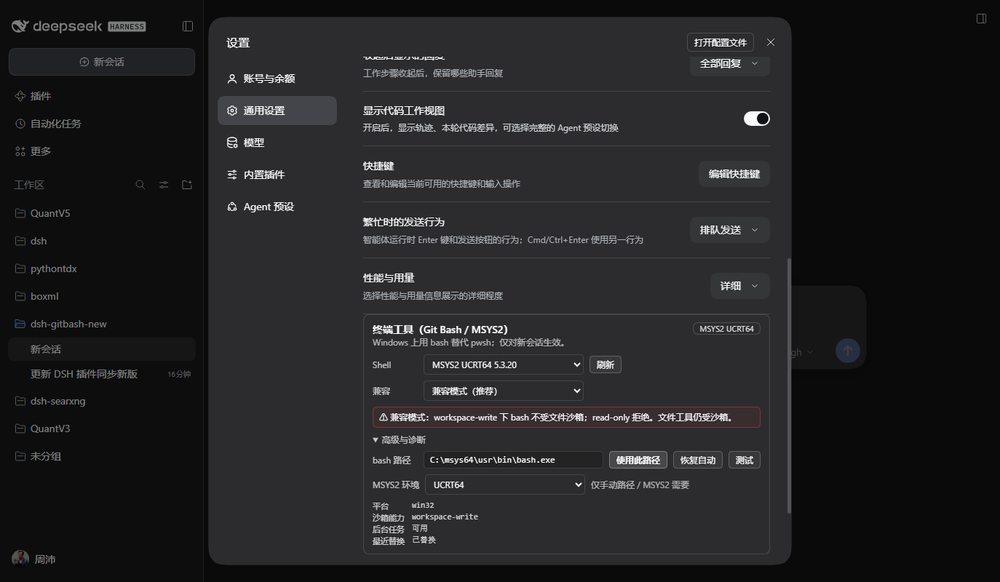
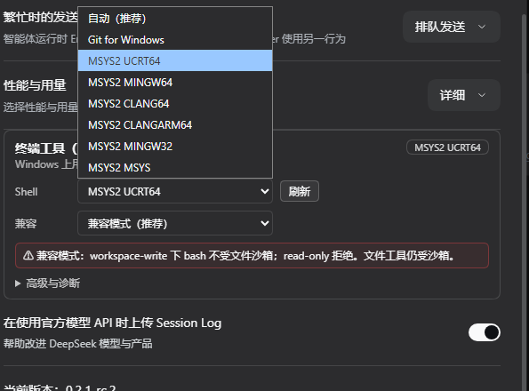
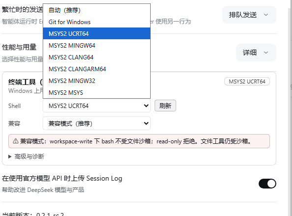

# dsh-gitbash

[English](README.md) | **简体中文**

一个面向 **DeepSeek Harness（DSH）** 的 Windows 终端桥：把模型侧的 `pwsh`
工具换成真正的 `bash`，并**同时支持、可选** Git for Windows 与 MSYS2，保留官方
终端工具的全部行为（cwd、后台任务、超时转后台、提权、终端卡片、PTC、`meta.cwd`）。

本文是完整使用手册：安装、日常用法、安全边界、设置、排障与开发。

> **最低 DSH：0.2.2。** 仅 Windows 10/11。替换只对**新会话**生效；已存在的会话
> 保持创建时的工具目录。

---

## 目录

- [功能](#功能)
- [环境要求](#环境要求)
- [安装](#安装)
- [快速开始](#快速开始)
- [安全边界（先读）](#安全边界先读)
- [使用 bash 工具](#使用-bash-工具)
- [Shell profile（Git / MSYS2）](#shell-profilegit--msys2)
- [设置页](#设置页)
- [常用操作](#常用操作)
- [排障](#排障)
- [诊断](#诊断)
- [兼容与升级](#兼容与升级)
- [开发](#开发)
- [限制与非目标](#限制与非目标)
- [License](#license)

---

## 功能

- **模型目录里只有 `bash`、没有 `pwsh`**：`tools.restrict` 隐藏 pwsh，压掉
  `tool:pwsh` 提示词，并注册本插件的 `bash`。只对新会话生效，旧会话不追溯。
- **两套 shell、一个选择器**：Git for Windows（默认优先）与 MSYS2（`UCRT64` /
  `MINGW64` / `CLANG64` / `CLANGARM64` / `MINGW32` / `MSYS`）。发现流程会查
  注册表、`where.exe`、PATH 与常见安装根目录，用 `bash --version` 校验候选，
  且不会把 WSL 的 `bash.exe` 当成候选。
- **与官方 terminal tool 同形的契约**：`description` / `command` / `timeoutMs` /
  `workdir` / `run_in_background` / `sandbox_permissions` / `justification`，
  同时接受 POSIX 与 Windows 形式的 workdir，结果标记（`[exit code: N]` /
  `[stderr]` / 截断 spill）与终端卡片用的 `meta.cwd` 都保持一致。
- **后台任务**：`run_in_background` 返回 job id，用 `job_output` 收集、
  `job_kill` 停止；前台超时会转后台（promote），而不是被杀掉。
- **隔离而非拼凑**：过滤另一套 bash 家族带来的 PATH 条目，`MSYSTEM` 始终与所选
  profile 一致；Git 的 `bin\bash.exe` launcher 会归一化为 `usr\bin\bash.exe`，
  确保实际运行的就是你组合出来的环境。
- **Windows 专有的正确性**：`signalNumber << 8` 的退出编码会归一化为
  `[killed by signal: SIGTERM]`；继承来的 Windows `PWD` / `OLDPWD` 用 tombstone
  删除，`pwd` 保持 POSIX。
- **DSH 原生显示**：终端卡片、标题栏 `1 个后台任务` / `1 个子智能体`、
  job 卡片和子智能体卡片都由 DSH 渲染。插件只注册 `bash` 工具并给出
  `meta.cwd`，不自绘聊天 UI。
- **紧凑设置页**：自动发现、即时 profile 选择、兼容模式、一行安全提示，
  路径/测试/环境/诊断折叠在“高级与诊断”。
- **显式安全**：绝不静默放宽权限——`workspace-write` 下以完全访问运行并在结果里
  标注 `[compat: ...]`，`read-only` 拒绝，`strict` 只允许 `danger-full-access`。
  详见[安全边界](#安全边界先读)。
- **已验证**：90 个单元/集成用例，加上 DSH `0.2.2-rc.1` 上的 Git 与 MSYS2 真机
  冒烟（直连、promote、后台、子智能体；0.2.4 审计轮 31/31 场景检查 + 15/15
  设置页检查，含 strict 实机拒绝）。

---

## 环境要求

| 项 | 要求 |
|---|---|
| DSH | `>= 0.2.2`（已在桌面运行时 `0.2.2-rc.1` 实测） |
| Windows | Windows 10/11 x64；MSYS2 arm64 环境也可用 |
| bash 提供方 | Git for Windows 和/或 MSYS2 |
| Node.js | `>= 24.9`，仅构建/开发需要（DSH 0.2.2 的工作区下限） |
| 可选 | Cygwin，best-effort，不推荐 |

- Git Bash 与 MSYS2 共用 MSYS2 运行时；该运行时无法在 DSH 的 Windows ACL 沙箱中
  启动。这是 OS 层约束，不是插件 bug（证据见
  [docs/DESIGN.md](docs/DESIGN.md) §2）。
- WSL 的 `bash.exe` 被有意排除：WSL 不是 Git Bash，也不符合本插件的
  profile/环境模型。

---

## 安装

### 使用 DSH Desktop 自带的 CLI

**不要**用 npm 全局的旧 `dsh`（例如 `0.1.7`），它不认识 0.2.2 的
plugin/profile 契约。使用桌面安装目录里的 CLI：

```bat
set "DSH_CLI=%LOCALAPPDATA%\Programs\DeepSeek Harness\resources\runtime\cli\bin\dsh.cmd"
%DSH_CLI% --version
:: 应为 0.2.2-rc.1 或更高
```

修改 profile 前先**完全退出 DSH Desktop**。

### 从本地目录安装（开发）

```bat
%DSH_CLI% plugin --profile desktop add link:D:/GitHub/dsh-gitbash-new
```

重新打开 DSH，浏览器硬刷新（`Ctrl+Shift+R`）。

### 从 GitHub 安装（发布后）

```bat
%DSH_CLI% plugin --profile desktop add github:riverzhou/dsh-gitbash-new
```

### 从 npm 安装（已发布）

```bat
%DSH_CLI% plugin --profile desktop add @riverzh/dsh-gitbash@0.2.4
```

最新版可用 `@riverzh/dsh-gitbash@latest`。

### 升级

```bat
%DSH_CLI% plugin --profile desktop remove @riverzh/dsh-gitbash
%DSH_CLI% plugin --profile desktop add link:D:/GitHub/dsh-gitbash-new
```

发布版把 `link:...` 换成 `@riverzh/dsh-gitbash@<version>`。升级后重启 DSH 并硬刷新。

### 卸载

```bat
%DSH_CLI% plugin --profile desktop remove @riverzh/dsh-gitbash
```

重启 DSH。设置项随插件消失；profile 的 `cordis.patch.yml` 里残留的
`dsh-gitbash` 配置不会再生效，可手动删除。

### 不要同时装两个“用 bash 换掉 pwsh”的插件

`dsh-tweaks` 的 `git-bash-terminal-tool` 也会隐藏 `pwsh` 并注册 `bash`。
如果它已经装了，先移除或禁用：

```bat
%DSH_CLI% plugin --profile desktop remove dsh-tweaks-git-bash-terminal-tool
```

两者同时存在时，先加载的一方完成替换；后加载的一方通常因 `pwsh` 已不可限制
而跳过，日志里会出现 `skipped ... pwsh is not restrictable`。

---

## 快速开始

1. 安装并重启 DSH。
2. 打开 **设置 → 通用 → 终端工具（Git Bash / MSYS2）**。
3. **Shell** 保持 **自动（推荐）**，或选一个具体的 Git/MSYS2 profile。
4. **兼容** 保持 **兼容模式（推荐）**；需要更严格时选严格模式。
5. 新建一个会话，让模型执行：
   *“用 bash 打印 shell、cwd 和 git status。”*
6. 确认模型调用的是 `bash`（不是 `pwsh`），结果的 cwd 正确。

设置页长这样：



Shell、兼容模式和 MSYS2 环境下拉都跟随 DSH 的浅色/深色 surface token，闭控件和
展开列表都保持可读：




---

## 安全边界（先读）

MSYS2 运行时**无法**在 DSH 的 Windows ACL 沙箱里启动：受限令牌会让它的命名共享
内存、signal 管道和 `BaseNamedObjects` 创建失败；把当前用户 SID 加进 restricting
列表会击穿写隔离；降到 Low 完整性又会再次卡在 `BaseNamedObjects`。不存在
“既能跑 Git Bash、又被这个沙箱约束”的配置。

因此插件把代价**显式化**：

| 会话权限 | `compat: auto`（默认） | `compat: strict` |
|---|---|---|
| `danger-full-access` | bash 正常执行 | bash 正常执行 |
| `workspace-write` | bash **以完全访问执行**，结果带 `[compat: ...]` | **拒绝** |
| `read-only` | **拒绝** | **拒绝** |

- **文件工具仍由 DSH 沙箱保护**；只有 bash 进程不受该沙箱约束。
- `workspace-write` + `auto` 下，bash 可以写工作区外的文件。除非用户明确要求，
  应把工作区外路径当作只读。
- 插件不会静默放宽权限：设置页红字、工具描述与 system prompt 都写明；每个未受
  沙箱约束的结果也带 `[compat: ...]` 尾注。
- `read-only` 宁可拒绝，也不破坏“只读”承诺。
- `strict` 给安全敏感用户：只在 `danger-full-access` 下允许 bash。
- 被策略阻止的调用可以用 `sandbox_permissions` + 一句 `justification` 重试；
  DSH 会询问用户，批准只对本次调用生效。

---

## 使用 bash 工具

### 参数

| 参数 | 类型 | 必填 | 说明 |
|---|---|---|---|
| `description` | string | 是 | 5–10 个词的清晰描述，显示在 UI |
| `command` | string | 是 | 以 `bash -c '<command>'` 执行；使用 POSIX 语法 |
| `timeoutMs` | number | 否 | 正数；默认 `120000`，上限 `600000` |
| `workdir` | string | 否 | 工作目录；相对路径基于会话 cwd |
| `run_in_background` | boolean | 否 | 立即返回 job id；不设超时 |
| `sandbox_permissions` | `workspace-write` \| `danger-full-access` | 否 | 被策略阻止时申请更宽模式 |
| `justification` | string | 提权时必填 | 一句话说明为什么本次需要更宽权限 |

`run_in_background` / `sandbox_permissions` 是特性探测的：标准 Web preset 组合了
job 服务与 sandboxing executor，因此都可用；极简组合可能只有基础参数。

每次调用都是**新的 shell**（`bash -c`），不是持久 PTY。需要换目录请用
`workdir`，不要在命令里依赖 `cd` 的跨调用状态。

### 结果格式

- stdout 原样返回；stderr 追加在 `[stderr]` 段头下。
- 无输出时为 `(no output)`。
- 非零退出码在最后一行加 `[exit code: N]`；信号加
  `[killed by signal: X]`。成功的前台结果通常没有退出标记，终端卡片会显示
  退出码 pill。
- 超时被杀：`[timed out after Nms]`。
- 超时转后台：
  `[still running after Nms; moved to background job <id>]`。
- 输出过大时截断尾部（默认每路 64,000 字节），并给出
  `[output truncated; full output: <file>]`；完整输出在 spill 文件里（最多 64 MiB）。
- 兼容提示：
  `[compat: bash runs outside the DSH file sandbox (session mode workspace-write)]`。
  这是**部署提示，不是命令 stderr**。
- 后台启动只返回 `started background job <id>`，没有 stdout；之后用
  `job_output` 读取。

`tool/result.meta.cwd` 是实际使用的 **Windows 绝对路径**。bash 里的 `pwd`
是 MSYS 的 POSIX 形式（如 `/d/project`）。

### 工作目录与路径

- 不传 `workdir`：使用 DSH 当前会话工作目录。
- 相对 `workdir`：基于会话 cwd 解析。
- 接受 Windows 绝对路径（`C:\...`）和 POSIX 盘符路径（`/c/...`、`/d/...`）；
  `/tmp` 映射到 Windows 临时目录。
- 其它 POSIX 绝对路径（如 `/home/...`）会明确报错，不猜测映射。
- 命令内优先用 POSIX 路径；用 `$VAR` / `${VAR:?}`，不要用 PowerShell 语法。

### 后台任务

- `run_in_background: true` 返回 job id，本轮对话继续。
- 用 `job_output`（`wait: true` 可阻塞等待）读取，用 `job_kill` 停止。
  它们是 DSH 内置 job 工具；本插件注册的 job kind 是 `bash`。
- Web UI 在会话标题栏显示后台任务徽章，在工作步骤里显示 job 卡片。
- 后台任务**没有超时**，需要显式停止。

### 超时与转后台

- 普通前台调用受 `timeoutMs` 约束（默认 120 秒，上限 10 分钟）。
- job 服务可用时，前台超时会**转成后台 job**，而不是杀掉；结果会给出 job id。
- job 服务不可用时，到点杀掉并报告超时。

### 权限提权

如果会话策略阻止命令，用最窄的更宽模式 + 理由重试：

```text
sandbox_permissions: "workspace-write"   // 或 "danger-full-access"
justification: "需要写 <路径> 下的构建缓存，因为 ..."
```

DSH 会请求用户批准；批准只对本次调用生效。`strict` 下 `workspace-write` 会被
拒绝，提权目标必须是 `danger-full-access`。

### 子智能体、PTC 与 UI

- DSH 子智能体继承父会话的工具层。父会话完成替换后，新子会话有 `bash`、
  没有 `pwsh`；Git 与 MSYS2 都已在真机验证。
- 子代理在自己的会话里执行 bash；父会话收到子智能体卡片/通知，标题栏显示
  `1 个子智能体`。点“查看子智能体”可进入子会话。
- PTC（`run_code`）看到同一个 `bash` 工具；插件提供 presenter 与
  `presentationMeta.cwd`。Web UI 从工具名、参数、结果标记和 `meta.cwd` 反推
  终端卡片。

---

## Shell profile（Git / MSYS2）

一个 profile 不只是 `bash.exe` 路径，还包含 flavor、安装根、MSYS2 环境和 PATH 规则。

| Flavor | 选择器文案 | `MSYSTEM` | bash 路径 |
|---|---|---|---|
| Git for Windows | `Git for Windows` | 固定 `MINGW64` | `<root>\usr\bin\bash.exe` |
| MSYS2 | `MSYS2 UCRT64`、`MSYS2 MINGW64` … | 所选环境 | `<root>\usr\bin\bash.exe` |
| Cygwin | `Cygwin`（experimental） | 不设置 | `<root>\bin\bash.exe` |

- **自动**优先 Git for Windows；没有 Git 时选已安装的最佳 MSYS2 环境
  （`UCRT64` 优先，然后 `MINGW64`、`CLANG64`、`CLANGARM64`、`MINGW32`、`MSYS`）。
- Git for Windows 只有一个 profile；MSYS2 每个已安装环境一个 profile。所有
  MSYS2 环境共用同一个 `usr\bin\bash.exe`，所以只存 `bashPath` 不够，
  必须同时存 `msystem`。
- MSYS2 环境必须真实存在（`<root>\ucrt64\bin` 等）；缺失时该 profile 无效，
  不会静默回退。

### Git 的 `bin\bash.exe` 会被归一化

Git for Windows 有两个入口：

- `bin\bash.exe` 是 **launcher**，会按安装自带的运行时重置 `MSYSTEM`/PATH
  （Git 2.56 是 UCRT64），覆盖我们设置的环境。
- `usr\bin\bash.exe` 才是运行时，会遵守我们组合的环境。

如果手填 `<root>\bin\bash.exe`，插件会把 profile 归一化为
`<root>\usr\bin\bash.exe`，生效路径会显示在设置页。这是真机抓到的 bug：
归一化前 Git profile 报 `MSYSTEM=UCRT64`，归一化后为 `MINGW64`。

### 环境隔离

| Profile | `MSYSTEM` | PATH 前缀（继承 PATH 之前） |
|---|---|---|
| Git | `MINGW64` | `<root>\bin`、`<root>\usr\bin`，以及存在的 `<root>\ucrt64\bin` / `mingw64\bin` / `mingw32\bin` |
| MSYS2 | 所选环境 | `<environmentRoot>\bin`、`<root>\usr\bin`、`<root>\usr\local\bin` |
| Cygwin | 不设置 | `<root>\bin` |

- 公共覆盖：`NO_COLOR=1`、`TERM=dumb`、`PAGER=cat`、`GIT_PAGER=cat`、
  `CHERE_INVOKING=1`。
- MSYS2 额外设置 `MSYS2_PATH_TYPE=inherit`。
- 另一套系统的根会被过滤：Git 会话不继承 `C:\msys64\usr\bin`；MSYS2 会话不继承
  Git 的 `usr\bin`。
- `DSH_*` 最后合并，保证优先；`HOME`、`TMP`、`TEMP`、`LANG` 不覆盖。

### 发现顺序

1. 配置的 `bashPath` + `msystem`（最高优先；无效就明确报错，不回退）。
2. Git 注册表 `InstallPath`（`HKLM` / `HKCU`）。
3. 已知根：Git（Program Files、LocalAppData、`C:\Git`、`D:\Git`）、MSYS2
   （`C:\msys64`、`D:\msys64`、LocalAppData、`C:\msys32`）、Cygwin
   （`C:\cygwin64`、`C:\cygwin`）。
4. `where git`（从 `git.exe` 反推根）与 `where bash`。
5. `PATH` 上的 `bash.exe` / `git.exe`。

WSL 一律排除：`System32\bash.exe`、`Sysnative`、`WindowsApps`、`\\wsl$`、
`wsl.exe` 都不会成为候选。版本探测只在点 **刷新** 或 **测试** 时发生；
打开设置页直接用缓存，不等待扫描。

---

## 设置页

打开 **设置 → 通用 → 终端工具（Git Bash / MSYS2）**。默认视图刻意保持很小：

- **Shell**：`自动（推荐）`、Git for Windows，或具体的 MSYS2 环境。选中即写入
  path + `msystem`。
- **刷新**：重新扫描根目录并探测 `bash --version` 版本/健康状态。
- **兼容**：兼容模式 / 严格模式；下面一行红字说明当前代价。
- **高级与诊断**：手动路径、**使用此路径**、**恢复自动**、**测试**、MSYS2
  环境，以及平台 / 沙箱能力 / 后台任务 / 最近替换。

右上角徽章显示**当前生效**的 profile；手填的 Git `bin` 路径归一化后，徽章可能
与输入框不同，这是正常的。

### 存了什么、何时生效

配置存在 profile 的 `cordis.patch.yml`：

```yaml
- id: dsh-gitbash
  config:
    bashPath: 'C:\Program Files\Git\usr\bin\bash.exe'
    msystem: MINGW64
    compat: auto
```

- `bashPath: ''` = 自动。
- `msystem` 为 `auto` 或具体 MSYS2 环境。Git profile 只接受 `auto` / `MINGW64`；
  其它值会按无效 profile 报错，而不是被静默忽略。
- `compat` 为 `auto` 或 `strict`。
- 配置在**新 agent 创建时**读取；**已存在的会话不会热切换**。开始新会话即可
  （子智能体会继承父会话）。
- 正常用设置表单；手改 patch 也可以，但需要重启 DSH。

---

## 常用操作

### 确认模型实际用的 shell

让模型执行：

> 用 bash 打印 `$MSYSTEM`、`command -v bash`、`bash --version`、`pwd` 和
> `git status`。

预期：Git 为 `MSYSTEM=MINGW64`，MSYS2 为所选环境；`bash` 指向选中的安装；
`pwd` 是 POSIX 形式，终端卡片显示 Windows cwd。

### 跑长时间服务

让模型用 `run_in_background: true` 启动，之后用 `job_output` 收日志、用
`job_kill` 停止。会话标题栏会出现后台任务徽章。

### 使用 MSYS2 工具链

1. 在 MSYS2 里安装环境，例如
   `pacman -S --needed mingw-w64-ucrt-x86_64-gcc`。
2. 设置页 **Shell** 选 **MSYS2 UCRT64**。
3. 让模型执行 `command -v gcc`，应命中 `C:\msys64\ucrt64\bin`。

### 让子智能体干活

让父会话用 `subagent` 派一个子任务，子任务里用 bash 执行命令。子代理有自己的
`bash`；父会话收到子代理报告，并显示子智能体卡片。点“查看子智能体”可看子会话。

### 修“Git 会话显示 UCRT64”

把 **Shell** 改回 **自动**（或选 Git for Windows）并刷新。手填的
`bin\bash.exe` 会归一化到 `usr\bin\bash.exe`；如果仍显示 UCRT64，通常是旧构建
或旧会话。

---

## 排障

| 现象 | 处理 |
|---|---|
| 设置页说没找到 bash | 安装 Git for Windows 或 MSYS2；点 **刷新**；或手填 `<root>\usr\bin\bash.exe`（不要加引号） |
| 新会话仍有 `pwsh` | 确认 DSH `>= 0.2.2`、插件在 profile bundles 里、DSH 已重启；看 `%TEMP%\dsh-gitbash.log` 的 `replace:` |
| 只有旧会话没有 bash | 替换按 agent 生效；新建会话。子代理从父会话继承 |
| Git 会话显示 `MSYSTEM=UCRT64` | 旧 `bin\bash.exe` 路径/旧构建；用自动/刷新；当前构建会归一化到 `usr\bin\bash.exe` |
| MSYS2 环境不存在 | 在 MSYS2 里安装该环境；profile 只列出 `bin` 存在的环境 |
| `CreateFileMapping ... Win32 error 5` / `couldn't create signal pipe` | 进程被放进了 Windows ACL 沙箱。本插件在 `compat: auto` 下不 confine bash；移除自定义 confine 或换标准 preset |
| `read-only` 拒绝 bash | 设计如此；切到 `workspace-write` / `danger-full-access`，或提权 |
| 严格模式拒绝 `workspace-write` | 把兼容改成 `auto`，切到 `danger-full-access`，或提权到 `danger-full-access` |
| 装了另一个插件后 pwsh/bash 都没了 | 两个 bash 替换插件冲突；只保留一个（见[安装](#安装)） |
| 后台任务不可用 | preset 没有组合 `ctx.jobs`；用标准 Web preset，或前台加超时 |
| 找不到 `job_kill` / `job_output` | 它们是 DSH 的独立工具，不属于 bash；确认 jobs 工具组在 preset 里 |
| 设置行不显示 | DSH 太旧、插件未加载，或 Web 客户端未重建/刷新；重启并硬刷新 |
| 找不到 Git/MSYS2 选择，或切换后当前会话没变 | 选择器只在 **设置 → 通用 → 终端工具（Git Bash / MSYS2）**；内置 **终端** 卡片是独立的 UI 终端插件。切换会立即保存，但只对**新会话**生效 |
| 路径含空格 | 填绝对路径即可；成对的单/双引号会被自动剥离 |
| WSL 的 bash 不出现 | 有意排除；WSL 不符合本插件的 profile/环境模型 |
| 输出像被截断 | 长输出只保留尾部；用结果里给的 spill 路径看完整文件 |

---

## 诊断

- **插件日志**：`%TEMP%\dsh-gitbash.log`（通常是
  `C:\Users\<你>\AppData\Local\Temp\dsh-gitbash.log`）。一行一条：
  `apply`、能力探测、`replace: applied ...` 或
  `skipped ... pwsh is not restrictable`。
- **设置状态**：`/api/dsh-gitbash/state`（需要认证），设置行用它；
  `/discover`、`/validate` 也是客户端接口，不是公开无认证 API。
- **DSH 开发者工具**：查看原始 session 事件、消息分组和 Node 后端，是 job /
  子智能体卡片的最终依据。
- **契约核对**：`pnpm compatcheck` 读取已安装运行时版本、执行插件的
  `engines.dsh` 下限，并对比部署的官方 Host / Client bundle 与本插件依赖的字符串。

完整的真机原始事件见 [docs/SMOKE.md](docs/SMOKE.md)。

---

## 兼容与升级

- 最低 DSH **0.2.2**。插件只使用官方服务的结构性投影（`ctx.subprocess`、
  `ctx.jobs`、`ctx.sandboxPolicy`、`ctx.shellEnv`、`ctx.workingDirectory`、
  `ctx.approval`、`ctx.configForms` 等），不 import 私有 DSH 包。
- 替换需要 `ctx.subprocess.spawn` **和** `ctx.sandboxPolicy.resolve`：bash 在
  DSH 沙箱之外启动，会话模式只能由 policy 服务给出。任一缺失时插件保留 preset
  的 `pwsh`，并在设置行显示缺失的能力。
- 关键集成点：`agent/created`、`tools.restrict`、`tool:bash` / `tool:pwsh` 的
  section 名、结果标记、`meta.cwd`。事件名写错是静默 no-op，所以测试会断言这些
  裸字符串。
- DSH 升级后：
  1. `pnpm compatcheck`
  2. `pnpm test`
  3. 改了 `src/` 就 `pnpm build`；提交的 `lib/` 必须与 `src/` 同步
  4. 重启 DSH，硬刷新 Web UI
- 非 Windows 不注册任何行为：`package.json` 声明
  `dsh.bundle.platforms: ["win32"]`（DSH 0.2.2 的 Host 准入），
  `cordis.patch.yml` 再在 `process.platform !== 'win32'` 时禁用 entry。

**2026-11-06 真机验证**：DSH `0.2.2-rc.1`、Git for Windows 2.56、MSYS2
5.3.20（UCRT64）；直接 bash、promote、后台任务、子智能体、SIGTERM 归一化、
相对 workdir、strict 拒绝与真实设置行（通过 UI 切到 MSYS2）均已跑过——干净加载
下 31/31 场景检查 + 15/15 UI 检查。原始事件见 [docs/SMOKE.md](docs/SMOKE.md)。

---

## 开发

```bash
pnpm install
pnpm build        # lib/index.js + lib/client.js
pnpm check        # tsc --noEmit
pnpm test         # node:test；90 个用例，含真实 Git/MSYS2（存在时）
pnpm selftest     # 纯逻辑自测，不需要 DSH
pnpm compatcheck  # 对已安装 DSH 做契约字符串核对
```

真实集成测试会自动发现本机 Git/MSYS2；没有时跳过。覆盖 `MSYSTEM`、PATH 隔离、
退出码、stderr、真实子 bash、超时、真实 `SIGTERM`/`SIGKILL` 编码、可选的 MSYS2
工具链，以及 compat 下“工作区外可写”的预期行为。

### 目录

```text
src/index.ts            host 入口：apply、Config、路由、替换
src/shared/protocol.ts  host/client 共用 wire 类型
src/host/               发现、环境、执行器、jobs、渲染、工具、路由
src/client/             设置行、store、API、locales
tests/                  单元 + 真实集成测试
scripts/                selftest、compatcheck
docs/                   设计、真机记录、截图
lib/                    构建产物，供 link: 安装
```

`src/` 与 `lib/` 必须同步；`link:` 安装实际加载 `lib/`。`docs/` 的唯一索引是
[docs/README.md](docs/README.md)，未登记的文档视为不存在。

### 打包

```bash
pnpm build
pnpm check
pnpm test
pnpm pack
```

npm 包名 `@riverzh/dsh-gitbash`（DSH entry id 仍是 `dsh-gitbash`），`engines.dsh = ">=0.2.2-0"`，`engines.node = ">=24.9.0"`。
包含 host 入口、client bundle、`lib/`、`src/`、`cordis.patch.yml`、docs 与两份
README。`dsh.bundle.platforms` 把 bundle 限定在 Windows，非 Windows 的 DSH 在读
patch 之前就会跳过它。

---

## 限制与非目标

- **one-shot bash**：每次调用都是 `bash -c`，不是持久 shell/PTY；`minimal`
  preset 的 persistent shell 不保留。
- **Windows 沙箱不兼容**：bash 无法被 confine；见[安全边界](#安全边界先读)。
  不存在让 MSYS2 安全跑在 ACL 沙箱里的开关。
- **不选 WSL**；Cygwin 只是 best-effort、experimental。
- **旧会话不迁移**；设置只对新 agent 生效。
- **后台任务无超时**；需要显式停止。
- **输出只保留尾部**；完整内容看 spill 文件。
- **替换按 agent 生效**：子代理从父会话继承，但插件启用前已存在的子代理不会热改。

---

## License

GNU General Public License v3.0 only（`GPL-3.0-only`），见 [LICENSE](LICENSE)。
